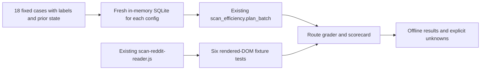

# Opportunity scan evaluation

A bounded, offline comparison of the **actual** opportunity-scan planner and Reddit DOM reader. It is inside the owning prospecting project. It does not alter the scanner, send messages, move a cutoff, read a private account, or run a model.

## What runs



The private project imports `_system/crm/scan_efficiency.py` directly. A public copy includes that same source file byte-for-byte and the existing `scan-reddit-reader.js` with its tests. `run.py` checks source/fixture SHA-256 bindings. This is real routing and extraction code, exercised with controlled fixtures; it is not a live scan or a substitute for the whole private pipeline.

## Run

From the private 10x repository root:

```sh
python3 measured-intuition/prospecting/benchmarks/run.py --output measured-intuition/prospecting/benchmarks/scorecard.json
python3 -m unittest discover -s measured-intuition/prospecting/benchmarks -p 'test_*.py' -v
node --test measured-intuition/prospecting/tests/test-scan-reddit-reader.mjs
```

In the public copy, run `python3 run.py --output scorecard.json`, `python3 -m unittest discover -s . -p 'test_*.py' -v`, and `node --test tests/test-scan-reddit-reader.mjs`. Python 3.9+ and Node 18+ suffice. No credentials, network, model, browser, server or production database are required. The output file is a local report; the scored fixture contains no private correspondence.

## Tasks and grading

`cases.json` has 18 fixed cases: two paraphrases of public original postings ([Reddit logistics buyer](https://www.reddit.com/r/AiAutomations/comments/1wimeua/hiring_ai_automation_systems_architect_to_rebuild/) and [OneSeven CAIO bench](https://jobs.oneseventech.com/fractional-chief-ai-officer-ai-transformation-engineering-leadership-276953/)) and 16 controlled synthetic variants. Public sources were checked October 28, 2026. The labels are author-authored, not independently adjudicated. Ten cases form a calibration partition and eight a held-out audit partition; after removing a duplicate and an already settled observation, the reported fresh-case partitions are ten and six. Neither partition authorizes scanner changes.

The adversarial set covers an implied buyer problem without hiring words, a repeated post, identical text from different buyers, a previously reviewed unchanged item, a changed version, a new reply, a truncated body, closed/expired roles and a prompt-injection string. The reader tests verify post permalink/date capture, limits, hidden/nested articles and explicit partial coverage. The prompt-injection fixture tests **routing of inert source text**, not whether a model would obey malicious instructions.

Two *existing planner configurations* run on identical cases and freshly reset in-memory prior state: baseline `weak_item_limit=0`, candidate `weak_item_limit=12`. Neither configuration has been applied to production by this evaluation. A `review` route means immediate model review; `triage` means lower-priority model review; `read_original` means the body must be completed first; `deferred` remains pending. A review route is not a qualified lead. Precision/recall are computed only against fresh author-labeled cases. There is no claim of search-wide recall.

| Bounded metric | Baseline | Candidate |
| --- | ---: | ---: |
| Cases planned | 18/18 | 18/18 |
| Direct review precision | 81.8% | 81.8% |
| Relevant fresh cases queued for review/triage | 9/12 (75.0%) | 11/12 (91.7%) |
| Relevant held-out cases queued | 3/5 (60.0%) | 4/5 (80.0%) |
| Deferred | 2 | 0 |
| Incomplete originals needing retrieval | 1 | 1 |
| Exact duplicate / unchanged version suppressed | 1 / 1 | 1 / 1 |
| Routing invariant failures / regressions | 0 / 0 | 0 / 0 |

The remaining relevant case is the intentionally truncated original. More triage increases possible model work; token cost was **not** measured. The planner's one-run elapsed time appears in `scorecard.json`, but it is not model or end-to-end latency. The existing Reddit reader passed six offline fixture tests. No model-task success, semantic requirement extraction, true deadline resolution, live source recall, user conversion or business ROI was measured. Those fields stay `not_reached`/`null` in the report.

## Boundaries and next experiments

The fixed collection proves a narrow tradeoff: increasing the weak-item cap reaches two subtle, relevant cases that the zero-cap configuration defers. It does **not** establish that the higher cap should be deployed. A later user-authorized experiment could replay real, privacy-reviewed captures with blinded labels and repeated model judgments, record actual tokens/latency, then compare downstream qualified leads and false positives. Closed-role and expired-deadline cases intentionally remain routed to review; source-status interpretation belongs to the next stage and is unmeasured here. If a source is inaccessible, the real scanner must record a coverage blocker, not an empty source.

The private workspace retains the full scanner. The public portfolio copy contains only the portable planner, Reddit reader, generic fixtures/tests and this report. It excludes WhatsApp, Slack, Bookface, Gmail, CRM/application data, account IDs, targeting criteria and source histories. See `SOURCE-BOUNDARY.md` for file-level provenance.
